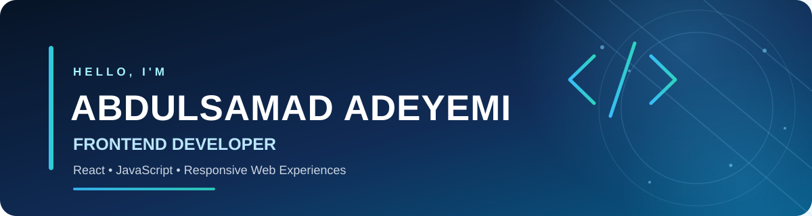

<!-- PROFILE HEADER -->

  

  

  <a href="mailto:adeyemiabdulsamad6@gmail.com"><strong>Let's work together</strong></a>
  &nbsp;·&nbsp;
  <a href="https://github.com/AbdulsamadAdeyemi?tab=repositories"><strong>Explore my projects</strong></a>

---

## About me

I'm **Abdulsamad**, a frontend developer and Computer Science student based in **Lagos, Nigeria**. I enjoy building responsive, user-friendly interfaces with **React and JavaScript**, and turning ideas into practical web experiences.

Currently learning more about frontend architecture, accessibility, and API integration. **Available for freelance projects and collaborations.**

## Tech I use

  

## Featured projects

| Project | What it does | |
|---|---|---|
| **SpendWise** | A React expense tracker for income, expenses, budgets, and spending insights. | [View project](https://github.com/AbdulsamadAdeyemi/Spendwise) |
| **Taskflow** | A task manager for organising work and keeping track of tasks. | [View project](https://github.com/AbdulsamadAdeyemi/taskflow) |
| **Weatherly** | A weather app that fetches conditions for searched locations. | [View project](https://github.com/AbdulsamadAdeyemi/Weatherly) |

## Let's connect

Have an idea, a project, or an opportunity? I'd love to hear about it.

  
  

📍 Lagos, Nigeria · Open to freelance work and collaborations

